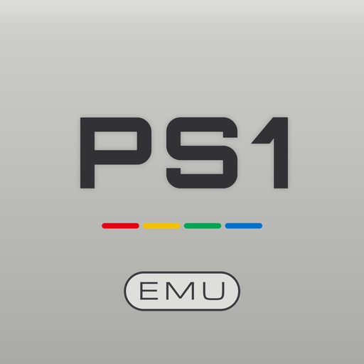
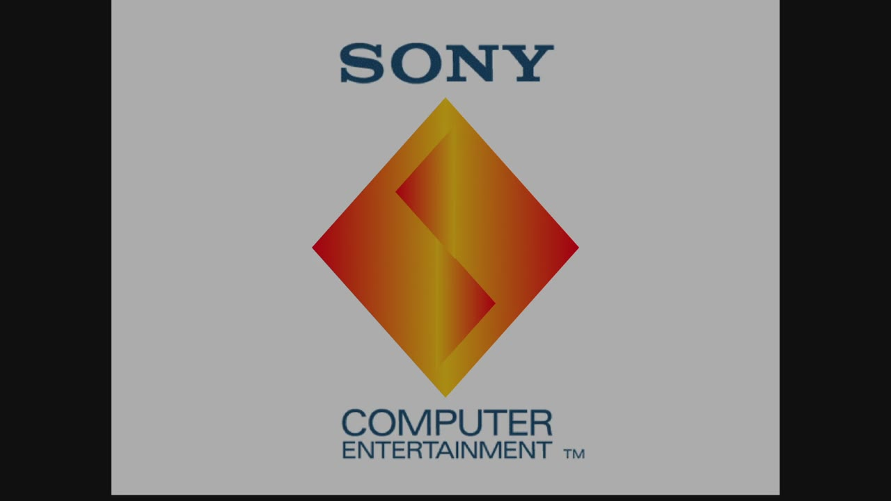
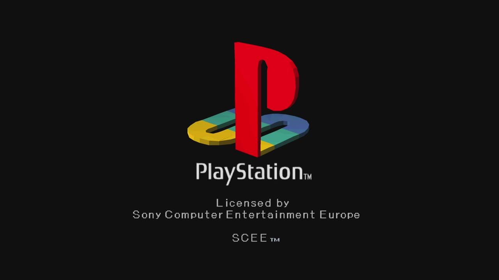
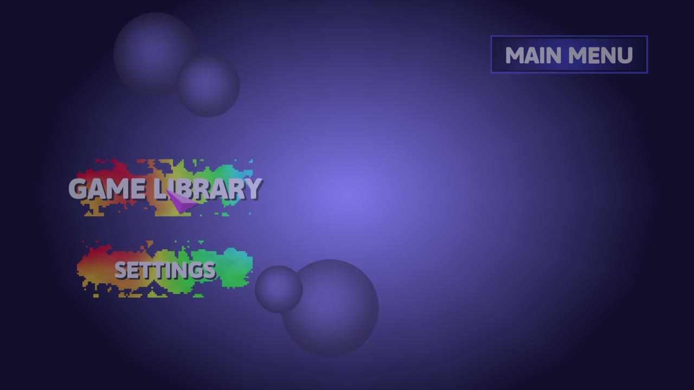
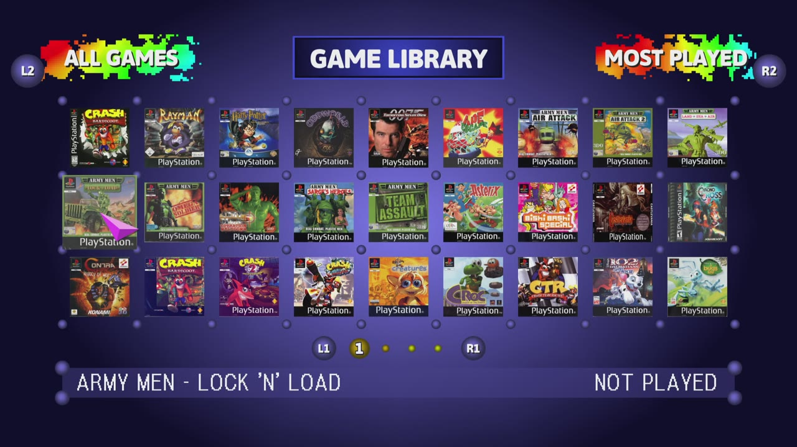
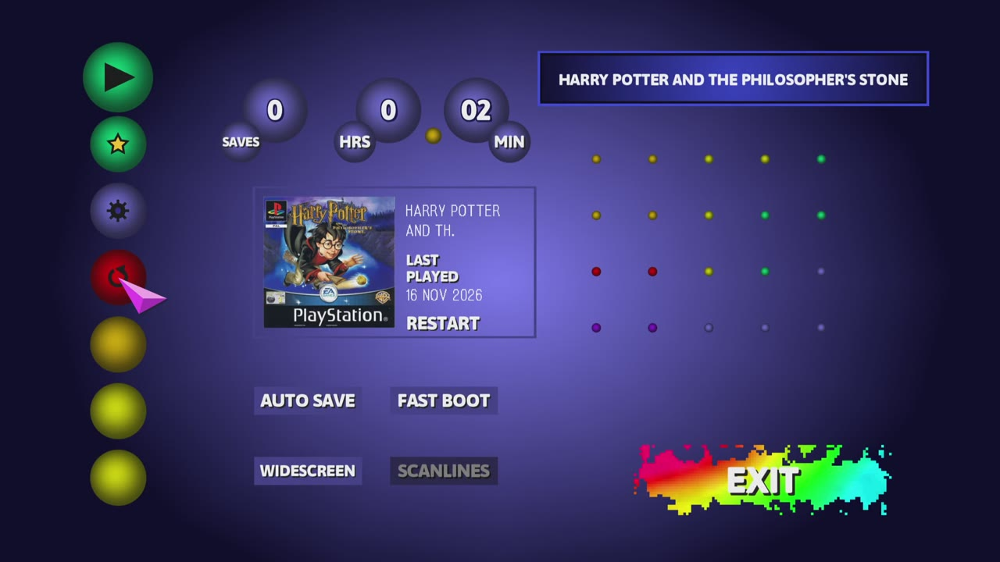
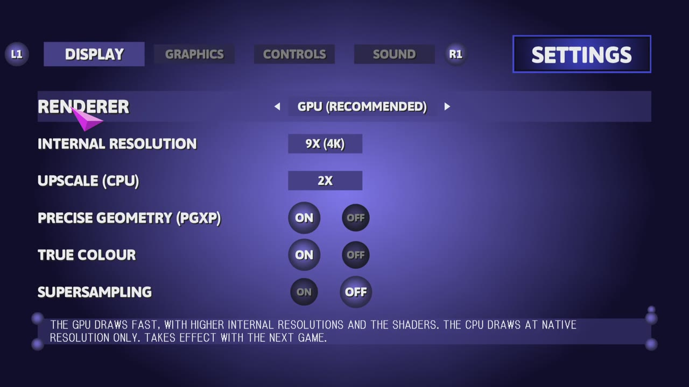

# Lineage PS1 for PS5

Hi, I'm kurolume :wave: Welcome to **Lineage**, my attempt at a faithful interface for emulators. Right now that's this and the [PS2 version](https://github.com/lineage-shell/lineage-ps2-for-ps5), both on PS5. In the future, I'd like to run the same design across PC emulators, from one shared core. There's a lot of research and QA before we get there though!

## The original PlayStation's menus, back on your PS5

This is a front end for [SwanStationPS5](https://github.com/darkxex/SwanStationPS5) that looks and behaves like a real PS1. It boots with the Sony screen and the PlayStation screen, then gives you the console's own style throughout: the blue light and spheres, memory card blocks, the CD Player and the grey settings screens.

None of Sony's stuff is in here. The logo screens, the font and the start-up sound come from your own BIOS (and the 3D PlayStation logo from one of your own discs).

<table>
<tr><td> Sony screen</td><td> PlayStation screen</td><td> Main menu</td></tr>
<tr><td> Game Library</td><td> Game page</td><td> Settings</td></tr>
</table>

Video: see the [v1.0 release](../../releases/tag/v1.0).

## Features

- **Rebuilt from the original console:** the Sony and PlayStation start-up screens with their real timing and sound, the main menu, memory cards and the grey PS one settings.
- **Added:** a Library of your games (search, favourites, play time), a page for each game with its discs and save states, the in-game menu styled as the CD Player, and memory card backup and restore.
- **Play like we used to** with your memory card saves, or pick up a save state if you've got one.
- **One combo for the in-game menu:** hold L3 + R3 to pause, save, load or quit. It's the same in every Lineage release, so no more forgetting how to get back to the emulator.
- **No BIOS yet?** It tells you what it needs and why, and you can still play with the built-in OpenBIOS.

## What you need

- A jailbroken PS5 with kstuff. Tested on firmware 11.40.
- A way to put homebrew apps on your home screen, e.g. [ShadowMountPlus](https://github.com/drakmor/ShadowMountPlus).
- An app unlocker, e.g. [etaHEN](https://github.com/etaHEN/etaHEN) or [LegacyJB](https://github.com/Phoenixx1202/LegacyJB), the same as SwanStationPS5 needs.
- Your own PS1 BIOS, dumped from your own console (or play with the built-in OpenBIOS).
- For physical discs: a USB CD drive and SwanStationPS5's disc payload (see [README-upstream.md](README-upstream.md)).

## Install

1. Grab `Lineage-PS1-v1.0-PPSA98511.zip` from [Releases](../../releases) and unzip it.
2. Copy the `PPSA98511` folder to `/data/homebrew/PPSA98511` and register it like any other homebrew app (restart ShadowMountPlus). The tile is called "PlayStation".
3. Put your PS1 BIOS in `/data/SwanStationPS5/bios`. You can change the folder in Settings > System > BIOS folder.

It sits alongside SwanStationPS5 and shares its games, saves and settings (under `/data/SwanStationPS5/`). To update, replace the folder. To remove it, delete the folder; your saves stay put.

**Only tested with SCPH-7002 v4.1 (PAL).** Other BIOS versions should work but I haven't tried them. If you do, let me know how it goes.

## Bugs and feedback

Open an [issue](../../issues) with your BIOS version, the game and what happened.

## Credits

- SwanStationPS5 (PS5 port): AngelXex ([darkxex](https://github.com/darkxex))
- PlayStation UI: @kurolume
- Emulator: [SwanStation](https://github.com/libretro/swanstation)
- Renderer (PSSwanStation): [Press5elect](https://github.com/Press5elect/PSSwanStation) and Crux2
- First frontend (PSXS5): SynoPiia

This build wouldn't be possible without SwanStationPS5, SwanStation, PSSwanStation or PSXS5, so a big thank you to everyone who's worked on them. Third-party code and fonts are listed in [THIRD_PARTY_NOTICES.md](THIRD_PARTY_NOTICES.md).

Built with the help of Claude (Anthropic).

## Want to help?

I've only got a couple of hours a week for this, so if you want to support and put some time in, drop me a line (@kurolume). That can be design or development. Whatever floats your boat :)

## Legal

Not affiliated with or endorsed by Sony Interactive Entertainment. No Sony code or assets are included; you need your own BIOS, dumped from your own console. "PlayStation" is Sony's trademark and is only used to say what this recreates.

GPL-3.0, same as SwanStation and SwanStationPS5. See [LICENSE](LICENSE).
